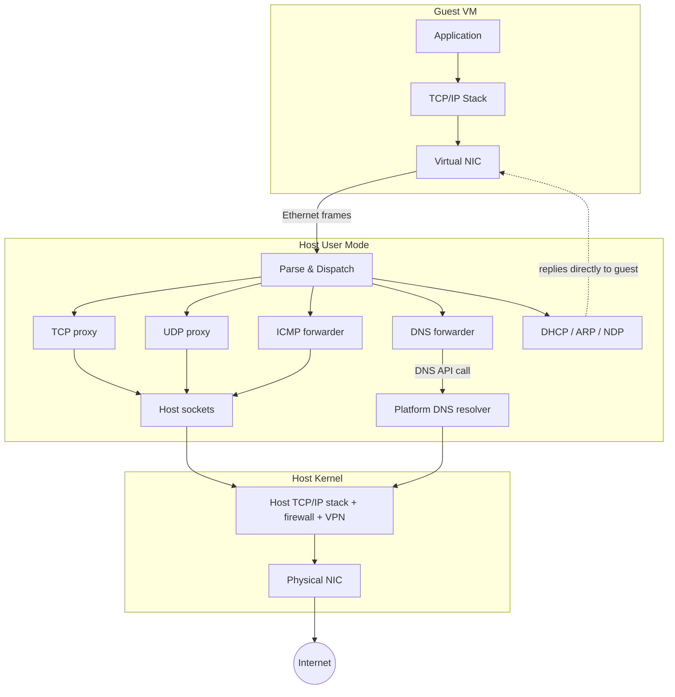

# Consomme

Consomme is a user-mode NAT that provides guest VM networking through
ordinary host sockets — no driver installation and no system-wide
network configuration. Because all traffic flows through standard
socket APIs, host networking policies (firewalls, VPN routing, proxy
settings) apply naturally, just as they would for any other application.

The guest sees a normal network: it gets an IP address via DHCP, has a
default gateway, and can resolve DNS names. Behind the scenes, Consomme
intercepts the raw Ethernet frames from the virtual NIC, parses them,
and translates them into socket calls on the host.



## microVM portable profile

OpenVMM microVMs select this backend with
`--net <IPv4/PREFIX> --network-profile portable`. This is the sole microVM
network profile and has the same Consomme behavior on Linux/KVM, Linux/MSHV,
and Windows/WHP. It provides gateway DNS over UDP and TCP, ICMP echo, and
outbound TCP/UDP subject to the microVM egress policy. IPv4 fragments are
rejected deterministically. `--net-tap` is incompatible.

The NIC is dual-stack. Its static IPv6 identity embeds the IPv4 identity in
`fd00::/96`, so `--net 10.0.0.2/24` gives the guest `fd00::a00:2/120` and the
gateway `fd00::a00:1`, which shares the IPv4 gateway's MAC address. The
gateway answers Neighbor Discovery for its subnet and echo requests to its
address, serves DNS at its address, and maps to host IPv6 loopback like the
IPv4 gateway maps to host IPv4 loopback. Consomme handles the static IPv6
identity whether or not the host has a routable IPv6 address, so other IPv6
destinations need IPv6 connectivity on the host. ICMPv6 other than Neighbor
Discovery and echo requests to the gateway is not relayed, and IPv6 packets
to IPv4-mapped destinations are rejected because a dual-stack host socket
would reach the embedded IPv4 host.

The portable profile accepts directional network defaults through
`--network-egress <allow|deny>` and `--network-ingress <allow|deny>`, and
supports both actions of each. Stateful replies to an allowed guest-initiated
flow are not treated as new inbound connections.

With ingress `allow`, the guest's listeners are published to the host's
private networks. OpenVMM appends `virtnet_ingress=allow` to the microVM
command line, and the guest announces the TCP and UDP ports on which it listens
in UDP datagrams to port 1021 of the IPv4 gateway, sent from a privileged
source port (see `net_backend_resources::ingress`). The endpoint consumes each
announcement before the egress policy and keeps one host listener per
announced port and address family, bound to every host address at the guest's
port number. A listener relays only peers whose addresses are not globally
reachable, such as private-use, shared, link-local, or unique local
addresses; it resets the TCP connections and drops the UDP datagrams of other
peers. It also refuses peers inside the guest's own subnets, which the guest
would take for its gateway or its neighbors, and IPv6 link-local peers, whose
replies would leave from the guest's link-local address. Peers at the host's
own addresses, including loopback, count as host
loopback and are admitted only with explicit `--host-loopback allow`. Replies
to admitted peers pass regardless of the egress policy: a TCP segment other
than an initial SYN, or a UDP datagram, that the policy denies is admitted
only when it continues a flow that Consomme carries. A UDP reply to a recent
peer of a published port leaves through that port's listener, before the
gateway interprets its destination, so the client sees it come from the
address and port that it reached. A publication may coexist with an explicit
forward to the same guest port. Ports that the host cannot bind, such as ones
that a host process holds, are retried with the next announcement. Snapshots
reject ingress `allow`.

The generic egress rule form accepts destination IPv4 or IPv6 addresses or
CIDRs, optionally restricted to TCP, UDP, or ICMP, and for TCP or UDP
optionally to one destination port or to an inclusive range of them. Each rule
matches only its own address family, and the directional default applies to
both. Deny rules take precedence over allow rules, and the explicit directional
default handles traffic that matches neither list. Filtering and
malformed-packet rejection occur before Consomme creates a host socket.
Port-specific policies reject IPv4 fragments rather than allowing later
fragments to bypass transport checks, and rule policies reject IPv6 extension
headers, including fragments. The legacy `--allow-host`, `--block-host`, and
`--allow-endpoint` forms are IPv4 policies that deny all IPv6.

The portable profile provides generic bidirectional host-loopback connectivity
with explicit `--host-loopback allow`, which needs no port list. The
guest-visible gateway then maps to host loopback, and the guest may reach
host-local destinations subject to the egress policy. Replies on the guest's
own flows come from the address and port that the guest addressed, such as the
gateway, as connected UDP sockets require. Consomme presents other host
peers to the guest at virtual addresses inside the guest's subnet of their
family, allocated downward from its high end, so that the guest answers them
from its address in that subnet. OpenVMM therefore requires an IPv4 network of
`/29` or larger for explicit `--host-loopback allow`: a `/30` holds only the
gateway and the guest and leaves no address for host peers. The endpoint's
egress policy evaluates the guest's traffic to such an address at the host
address to which Consomme routes it, and for host loopback at the gateway of
its family, so a peer's virtual address reaches no host-loopback port that the
rules deny at the gateway. Without ingress `allow`, OpenVMM appends
`virtnet_ingress=host-loopback` to the microVM command line, and the guest
announces its listeners as it does for ingress `allow`. The endpoint keeps one
host listener per announced port and address family, bound to the family's
loopback address alone at the guest's port number, so that neither the host's
private networks nor the internet can reach it, and admits only the host. A
host listener that already holds the port, including one bound to every host
address, keeps it. A host listener that binds every host address later fails
on Linux; on Windows, unless it asks for exclusive use of the port, it
succeeds, and the publication keeps the port's loopback traffic, as a loopback
listener of any host process would. Replies to the host pass regardless of the
egress policy, as they do for ingress `allow`. A guest listener bound to guest
loopback alone is never announced and remains private to the guest. With
ingress `allow`, the listeners published to the host's private networks admit
the host instead. Deliberate TCP/UDP forwards publish further
localhost-to-guest ports, possibly remapped to other guest ports. Snapshots
reject explicit `--host-loopback allow`.

Omitting `--host-loopback` preserves the existing guest-to-host mapping but
does not publish guest ports. `deny` rejects general gateway socket traffic
and all host-to-guest forwards. One exact gateway TCP port may remain mapped
as a proxy exception; UDP on that same port and other host service ports stay
blocked even when ordinary egress is allowed.

Snapshot restore creates a fresh endpoint generation. Host sockets and NAT
flow tables are not saved. Virtio-net capture drains descriptor ownership
before state is saved, and restored guest software must establish new
host-side flows.

## Default network topology

| Role | IPv4 Address |
|------|-------------|
| Guest | `10.0.0.2` |
| Gateway | `10.0.0.1` |
| Subnet mask | `255.255.255.0` |

The subnet is configurable via the `--net consomme:<cidr>` CLI option.
The gateway is always `.1` and the guest is always `.2`.

## Port forwarding

By default, Consomme only provides outbound connectivity from the guest.
To accept inbound connections, use the `hostfwd=` option to forward
host ports into the guest:

```bash
--net consomme:hostfwd=tcp::2222-:22
```

This binds host port 2222 and forwards incoming TCP connections to
guest port 22. The general syntax is:

```text
hostfwd=<proto>:[<hostaddr>]:<hostport>-[<guestaddr>]:<guestport>
```

| Field | Description |
|-------|-------------|
| `proto` | `tcp` or `udp` |
| `hostaddr` | Host IP to bind (default: all IPv4 interfaces, `0.0.0.0`). Use `[addr]` brackets for IPv6 addresses |
| `hostport` | Host port to listen on. Use `0` for any available port |
| `guestaddr` | Currently ignored — traffic always forwards to the guest IP |
| `guestport` | Guest port to forward to |

Multiple forwards can be specified with commas:

```bash
--net consomme:hostfwd=tcp::2222-:22,hostfwd=tcp::3389-:3389
```

Port forwards can also be combined with a CIDR:

```bash
--net consomme:10.0.0.0/24,hostfwd=tcp::2222-:22
```

Examples:

```bash
# Forward host port 8080 to guest port 80
--net consomme:hostfwd=tcp::8080-:80

# Bind only to localhost
--net consomme:hostfwd=tcp:127.0.0.1:8080-:80

# IPv6 localhost
--net consomme:hostfwd=tcp:[::1]:8080-:80

# UDP forwarding
--net consomme:hostfwd=udp::5353-:53
```

IPv6 is enabled when the host has a routable IPv6 address. Consomme
advertises a prefix via SLAAC and the guest auto-configures its own
address. IPv6 DNS servers are advertised via RDNSS (in Router
Advertisements) and DHCPv6 Information-Request.

## Protocol handling

### TCP

Consomme maintains a full TCP state machine on the guest-facing side
and opens a real host socket per connection. Data flows through ring
buffers between the two sides. This is a split-TCP design: there are
two independent TCP connections (guest↔Consomme and host↔remote server)
stitched together.

Key implications of the split-TCP design:

- **Congestion control is disconnected from the real network.** The
  guest sees a virtual link with zero packet loss and sub-microsecond
  RTT. Its congestion window opens wide almost immediately. The host
  kernel's TCP stack handles all real congestion and retransmission.
- **Another TCP stack to debug.** When a connection stalls, there are
  three TCP implementations in play: the guest's, Consomme's, and the
  host kernel's. Diagnosing which one is misbehaving requires visibility
  into Consomme's internal state.

Consomme supports TCP Segmentation Offload (TSO) from the guest NIC,
window scaling, and MSS negotiation.

The per-connection ring buffers autotune. Each connection starts with a
small buffer (16 KiB by default) and grows on demand — doubling under
sustained throughput pressure up to a ceiling (4 MiB by default) — so
idle and short-lived connections stay cheap while bulk transfers can
ramp up to a large window. Embedders can override the bounds via the
`tcp_rx_buffer` and `tcp_tx_buffer` fields on `ConsommeParams` (each a
`TcpBufferBounds { initial, max }`); the values are clamped to
`[16 KiB, 4 MiB]` and rounded up to a power of two. Setting
`initial == max` pins a fixed size and disables growth.

Connections waiting for the peer to advance a TCP close handshake use a
60-second inactivity timeout by default, including connections closed before
their initial handshake completes. `CloseWait` is excluded because the local
backend can still produce data; its timeout starts when the backend closes and
the connection enters `LastAck`. ACKs and newly accepted data restart the
timeout. Embedders can override it with the `tcp_close_timeout` field on
`ConsommeParams`. The same duration is used for `TimeWait`, where it
represents the 2*MSL wait required by RFC 9293. A separate fixed 60-second
timeout bounds initial handshakes that receive no close request.

Inbound connections require explicit port forwarding — OpenVMM can
programmatically bind host ports and forward them into the guest.

### UDP

Each unique guest source socket (guest IP + source port) gets a
host-side UDP socket bound to an ephemeral port. Datagrams are
forwarded in both directions. Idle bindings are cleaned up after a
configurable timeout (5 minutes by default, per RFC 4787).

Consomme admits at most 256 active guest UDP flows, 128 active guest TCP flows,
and 16 guest ICMP source flows by default. It rejects an excess flow before
creating its host socket; it never evicts an active flow to make room.

UDP packets to the gateway on well-known ports are intercepted:

- **Port 67** — handled by the built-in DHCP server
- **Port 53** — handled by the DNS forwarder

UDP segmentation offload and receive coalescing are not currently
supported. Each datagram requires a separate socket call, which may
matter for QUIC/HTTP/3 performance.

### DNS

The guest is told (via DHCP) to use the gateway as its DNS server.
Queries to the gateway on port 53 are intercepted and forwarded to the
host's DNS resolver. On Windows, this uses the `DnsQueryRaw` API, which
forwards the raw DNS packet without parsing — the host resolver handles
all the logic and returns a raw response. On Unix-like hosts, Consomme
uses the system resolver configuration (for example `/etc/resolv.conf`)
and forwards queries via host UDP/TCP sockets. This means guest DNS
resolution matches the host's behavior, including corporate VPNs and
split-tunnel DNS configurations.

DNS over TCP is also supported for large responses.

### ICMP

Echo requests (ping) are forwarded through a host-side ICMP socket.
The guest's TTL is preserved, so ping works and traceroute partially
works (the echo reply comes back, but intermediate TTL Exceeded hops
are not relayed — see limitations).

### ARP and NDP

- **ARP** — Responds to requests for the gateway and for on-link next hops
  admitted by exact endpoint policy, using the gateway MAC as the proxy
  address. The shared egress policy accepts only guest-identity requests for
  its canonical next-hop set, so resolving an endpoint does not authorize
  unrelated IPv4 traffic.
- **NDP** — Responds to Router Solicitations (advertising the IPv6
  prefix and DNS servers) and Neighbor Solicitations for the gateway's
  link-local address. DAD is silently ignored.

### DHCP

Built-in DHCPv4 server assigns the guest its IP address, gateway, and
DNS servers. Lease duration is 24 hours. DHCPv6 Information-Request is
also handled (stateless — provides DNS servers to SLAAC-configured
guests).

## Checksum and segmentation offload

Consomme supports the following offloads from the guest NIC:

- IPv4 header checksum offload
- TCP checksum offload
- UDP checksum offload
- TCP Segmentation Offload (TSO)

## Limitations

### No multicast or broadcast

Beyond ARP, DHCP, and the NDP multicast messages required for IPv6,
Consomme only processes unicast traffic. Protocols that rely on
multicast discovery do not work:

- **mDNS / Bonjour** — printer, AirPlay, Chromecast discovery
- **SSDP / UPnP** — device discovery, NAT-PMP port mapping
- **LLMNR** — Windows local name resolution fallback
- **NetBIOS** — legacy Windows browsing

### No ICMP error relay

ICMP error messages (Destination Unreachable, TTL Exceeded, etc.) are
not forwarded to the guest:

- **TCP** — unreachable hosts produce a TCP RST instead of an ICMP
  error. The connection fails, but the guest can't distinguish "host
  unreachable" from "connection refused."
- **UDP** — Port Unreachable errors are silently swallowed.
- **Traceroute** — TTL Exceeded replies from intermediate routers are
  not relayed, so the hop-by-hop path is not visible.

### No IP fragment reassembly

Fragmented IP packets from the guest are silently dropped. This only
affects UDP datagrams larger than ~1472 bytes. TCP is never affected
because the guest kernel segments at the TCP layer. On the host side,
fragmentation is handled transparently by the kernel socket layer.

### No jumbo frames

MTU is fixed at 1500 bytes.

### No ICMPv6 Echo

IPv6 ping does not work. IPv6 TCP and UDP work normally.

### No non-TCP/UDP/ICMP protocols

GRE, ESP, SCTP, and other IP protocols are silently dropped. This
means VPNs that terminate inside the guest and use IPsec (ESP) or
PPTP (GRE) will not work. UDP-based VPNs like WireGuard work fine.
IKEv2 with NAT-T (UDP-encapsulated ESP on port 4500) also works.

VPNs running on the host work transparently — Consomme's traffic flows
through the host network stack like any other application.

### IPv6 depends on host

IPv6 is only enabled if the host has a routable IPv6 address at VM
start time.

### Static DNS records only support the `A` record type

Only `A` records are currently supported.
`AAAA` queries for names with a static `A` record return `NOERROR` with no
answers, rather than being forwarded to the upstream resolver.

### Static DNS records don't support DNSSEC

All static DNS replies are returned with the AD flag unset.

## Crate structure

| Crate | Path | Purpose |
|-------|------|---------|
| `consomme` | `vm/devices/net/net_consomme/consomme/` | Core user-mode TCP/IP stack |
| `net_consomme` | `vm/devices/net/net_consomme/` | [`net_backend::Endpoint`](https://openvmm.dev/rustdoc/linux/net_backend/trait.Endpoint.html) integration |
